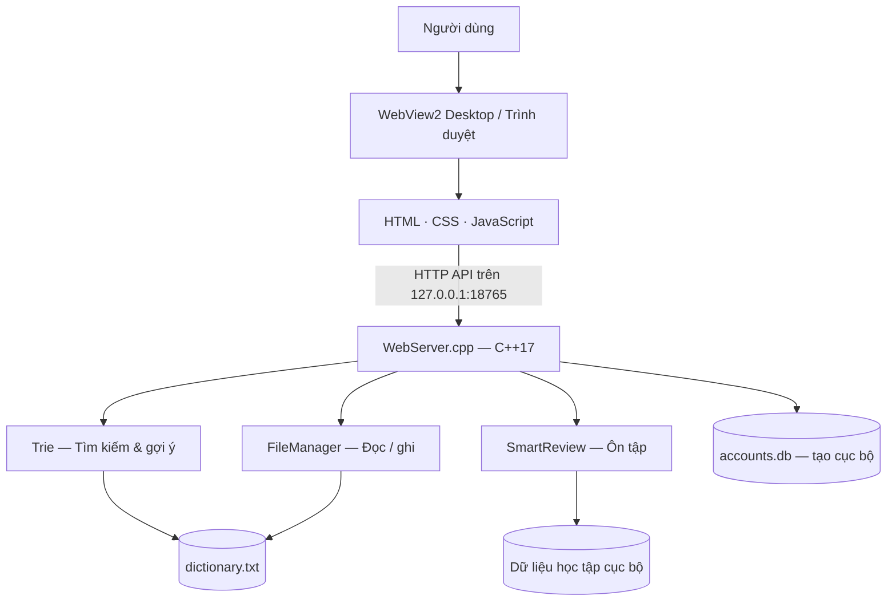

<div align="center">

# 📚 LEXITRIE — HỆ THỐNG TỪ ĐIỂN ANH–VIỆT THÔNG MINH

### Ứng dụng tra cứu từ vựng, gợi ý tiền tố và ôn tập thông minh dựa trên Trie


**Đồ án môn Cấu trúc dữ liệu và Giải thuật (CTDL & GT) — Đề tài ĐT06**

[📂 Mã nguồn GitHub](https://github.com/LuuTrongNguyenn/AnhViet_Dictionary) · [🚀 Hướng dẫn chạy](#-hướng-dẫn-cài-đặt--khởi-chạy) · [🧪 Kiểm thử](#-kiểm-thử--đánh-giá-hiệu-năng)

</div>

---

## 📑 Mục lục

- [Giới thiệu tổng quan](#-giới-thiệu-tổng-quan)
- [Kiến trúc hệ thống](#-kiến-trúc-hệ-thống)
- [Cấu trúc thư mục](#-cấu-trúc-thư-mục)
- [Các tính năng chính](#-các-tính-năng-chính)
- [Cấu trúc dữ liệu & thuật toán](#-cấu-trúc-dữ-liệu--thuật-toán)
- [Hướng dẫn cài đặt & khởi chạy](#-hướng-dẫn-cài-đặt--khởi-chạy)
- [Kiểm thử & đánh giá hiệu năng](#-kiểm-thử--đánh-giá-hiệu-năng)
- [Dữ liệu & bảo mật](#-dữ-liệu--bảo-mật)
- [Thành viên & phân công](#-thành-viên--phân-công)

---

## 🌟 Giới thiệu tổng quan

**LexiTrie** là ứng dụng từ điển Anh–Việt kết hợp công cụ học từ vựng, xây dựng bằng **C++17**. Hệ thống sử dụng **Trie (Prefix Tree)** để quản lý từ tiếng Anh và **DFS (Depth-First Search)** để gợi ý từ theo tiền tố.

Dự án có **giao diện desktop bằng Microsoft WebView2**, sử dụng HTML/CSS/JavaScript để hiển thị và **backend C++** để xử lý dữ liệu. Ngoài ra còn có giao diện console phục vụ thực hành và kiểm thử.

**Điểm nổi bật:**

- 📖 Dữ liệu từ điển Anh–Việt khoảng **77.568 mục từ** trong `data/dictionary.txt`.
- ⚡ Tìm kiếm, thêm, cập nhật, xóa từ bằng Trie.
- 🔎 Tự động gợi ý từ theo tiền tố khi nhập.
- 🧠 Smart Review: quản lý từ đã học, ôn tập, thống kê và lịch sử.
- 🔐 Đăng ký, đăng nhập tài khoản cục bộ trên backend.
- 📊 Bộ kiểm thử Trie và benchmark đo hiệu năng.

## 🏗️ Kiến trúc hệ thống



| Thành phần | Công nghệ | Vai trò |
|---|---|---|
| Core Engine | C++17 | Xử lý Trie, tìm kiếm và dữ liệu |
| Thuật toán | Trie + DFS | Tra cứu từ và autocomplete |
| Backend | C++ / Winsock | Cung cấp HTTP API nội bộ |
| Frontend | HTML, CSS, JavaScript | Giao diện và tương tác |
| Desktop Host | .NET 8 + Microsoft WebView2 | Hiển thị giao diện trong cửa sổ Windows |
| Lưu trữ | Tệp văn bản UTF-8 và dữ liệu cục bộ | Từ điển, từ loại, chủ đề và tiến độ học |

## 📁 Cấu trúc thư mục

```text
AnhViet_Dictionary/
├── README.md
├── build_webview2.bat             # Build backend và mở giao diện
├── .gitattributes
├── include/
│   ├── Trie.h
│   ├── FileManager.h
│   ├── SmartReview.h
│   └── ConsoleUI.h
├── src/
│   ├── Trie.cpp
│   ├── FileManager.cpp
│   ├── SmartReview.cpp
│   ├── ConsoleUI.cpp
│   ├── WebServer.cpp
│   └── main.cpp
├── data/
│   ├── dictionary.txt             # Dữ liệu Anh–Việt
│   ├── word_parts.txt             # Từ loại
│   └── word_topics.txt            # Chủ đề từ vựng
├── web/
│   ├── index.html
│   ├── style.css
│   ├── app.js
│   ├── login.css
│   └── login.js
├── WebViewHost/
│   ├── Program.cs
│   └── WebViewHost.csproj
├── tests/
│   └── test_trie.cpp
└── benchmarks/
    └── benchmark.cpp
```

> Cây thư mục trên dựa trên phiên bản `main` được kiểm tra. Các thư mục `obj/`, `bin/`, `publish/` và tệp `.exe` có thể được sinh ra khi biên dịch, không phải mã nguồn cần đưa lên GitHub.

## ✨ Các tính năng chính

### 1. Tra cứu từ điển Anh–Việt

- Tìm từ tiếng Anh và hiển thị nghĩa tiếng Việt.
- Hỗ trợ tra cứu qua giao diện WebView2 và console.
- Thông báo khi không tìm thấy từ.

### 2. Autocomplete — Gợi ý từ thông minh

- Gợi ý từ theo tiền tố người dùng đang nhập.
- Duyệt cây Trie bằng DFS để lấy các từ phù hợp.
- Backend hỗ trợ trả về danh sách gợi ý giới hạn cho giao diện.

### 3. Quản lý từ vựng

- Thêm từ mới, cập nhật nghĩa, xóa từ.
- Nạp và lưu từ điển thông qua `FileManager`.
- Sử dụng dữ liệu từ loại và chủ đề hỗ trợ tra cứu.

### 4. Smart Review — Ôn tập từ vựng

- Thêm từ vào danh sách học và ôn tập.
- Ghi nhận kết quả trả lời đúng/sai.
- Theo dõi từ cần ôn, từ còn sai và lịch sử phiên học.
- Tổng hợp số lần ôn, độ chính xác và hoạt động theo ngày.

### 5. Tài khoản cục bộ

- Đăng ký, đăng nhập và đăng xuất.
- Backend tạo phiên đăng nhập bằng cookie.
- Dữ liệu tài khoản được lưu cục bộ trong `data/accounts.db` khi sử dụng.

### 6. Kiểm thử và benchmark

- Kiểm tra các thao tác chính của Trie qua `tests/test_trie.cpp`.
- Đo thời gian xử lý Trie qua `benchmarks/benchmark.cpp`.

## 🧩 Cấu trúc dữ liệu & thuật toán

**Trie (Prefix Tree)** lưu trữ các từ theo từng ký tự trên các nhánh chung. Đây là cấu trúc dữ liệu trung tâm của đồ án.

| Thao tác | Ý tưởng | Độ phức tạp điển hình |
|---|---|---|
| Thêm từ | Duyệt hoặc tạo nút theo từng ký tự | `O(L)` |
| Tìm từ | Duyệt đường đi theo ký tự | `O(L)` |
| Xóa từ | Tìm từ và xử lý các nút không còn cần thiết | `O(L)` |
| Gợi ý từ | Tìm nút tiền tố, sau đó DFS các nhánh con | Phụ thuộc số nút duyệt và số kết quả |

`L` là độ dài từ. Độ phức tạp trên giả định thao tác truy cập nhánh ký tự có chi phí hằng số.

## 🚀 Hướng dẫn cài đặt & khởi chạy

### 1. Yêu cầu môi trường

- **Windows 10/11**.
- **MSYS2 UCRT64** với trình biên dịch `g++` hỗ trợ C++17, tại `C:\msys64\ucrt64\bin\g++.exe` theo cấu hình script hiện tại.
- **.NET 8 SDK** và khả năng tải gói Microsoft WebView2 khi build lần đầu, để chạy cửa sổ desktop.
- **Microsoft Edge WebView2 Runtime** để sử dụng WebView2.

### 2. Tải mã nguồn

```powershell
git clone https://github.com/LuuTrongNguyenn/AnhViet_Dictionary.git
cd AnhViet_Dictionary
```

Hoặc tải **Code → Download ZIP** trên GitHub, giải nén và mở Terminal tại thư mục gốc.

### 3. Build và chạy WebView2

Trong PowerShell:

```powershell
.\build_webview2.bat
```

Script sẽ:

1. Biên dịch backend C++ thành `LexiTrieBackend.exe`.
2. Khởi động backend tại **http://127.0.0.1:18765/**.
3. Build và mở cửa sổ WebView2; nếu không build được host, thử mở giao diện bằng trình duyệt.

> **Lưu ý về trạng thái hiện tại:** Trong lần chạy thực tế gần nhất, backend **chưa biên dịch thành công** do lỗi nhận diện `SmartReview`/`FileManager`. Nhóm cần sửa lỗi tích hợp và chạy kiểm tra lại trước khi công bố ứng dụng hoạt động hoàn chỉnh. Việc có đầy đủ file không đồng nghĩa build đã thành công.

### 4. Dừng backend

Đóng cửa sổ backend hoặc dùng lệnh:

```powershell
taskkill /IM LexiTrieBackend.exe /F
```

## 🧪 Kiểm thử & đánh giá hiệu năng

### Kiểm thử Trie

Tại thư mục gốc, dùng PowerShell:

```powershell
& "C:\msys64\ucrt64\bin\g++.exe" -std=c++17 -Iinclude tests\test_trie.cpp src\Trie.cpp src\FileManager.cpp -o test_trie.exe
.\test_trie.exe
```

### Benchmark Trie

```powershell
& "C:\msys64\ucrt64\bin\g++.exe" -std=c++17 -O2 -Iinclude benchmarks\benchmark.cpp src\Trie.cpp -o benchmark.exe
.\benchmark.exe
```

Kết quả benchmark phụ thuộc cấu hình máy, dữ liệu đầu vào và môi trường biên dịch.

## 🔒 Dữ liệu & bảo mật

- Dữ liệu từ điển được lưu trong `data/dictionary.txt` và các tệp bổ trợ.
- `data/accounts.db` chứa thông tin xác thực cục bộ, **không nên commit lên GitHub**.
- Các tệp build như `*.exe`, `obj/`, `bin/`, `publish/` nên được loại khỏi commit.
- Backend lắng nghe tại `127.0.0.1:18765`, phục vụ ứng dụng trên máy đang chạy.

## 👥 Thành viên & phân công

| Thành viên | Phần phụ trách | Thành phần |
|---|---|---|
| **Lưu Trọng Nguyên** | Trie, giao diện WebView2, benchmark và kiểm thử Trie | `Trie.*`, `web/`, `WebViewHost/`, `benchmarks/`, `tests/` |
| **Châu Thiện An** | Console và backend API | `ConsoleUI.*`, `src/main.cpp`, `src/WebServer.cpp` |
| **Dương Đình Khánh** | Quản lý dữ liệu và Smart Review | `FileManager.*`, `SmartReview.*`, `data/` |

> Mỗi thành viên phát triển trên nhánh riêng, commit bằng tài khoản cá nhân và tạo Pull Request để tích hợp vào `main`.

---

<div align="center">

**LEXITRIE · CTDL & GT · ĐT06**

*Ứng dụng từ điển Anh–Việt sử dụng Trie và DFS, phát triển bằng C++17.*

</div>
